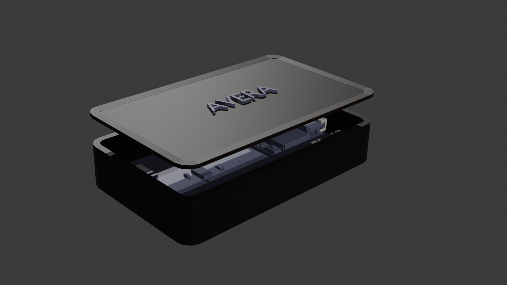
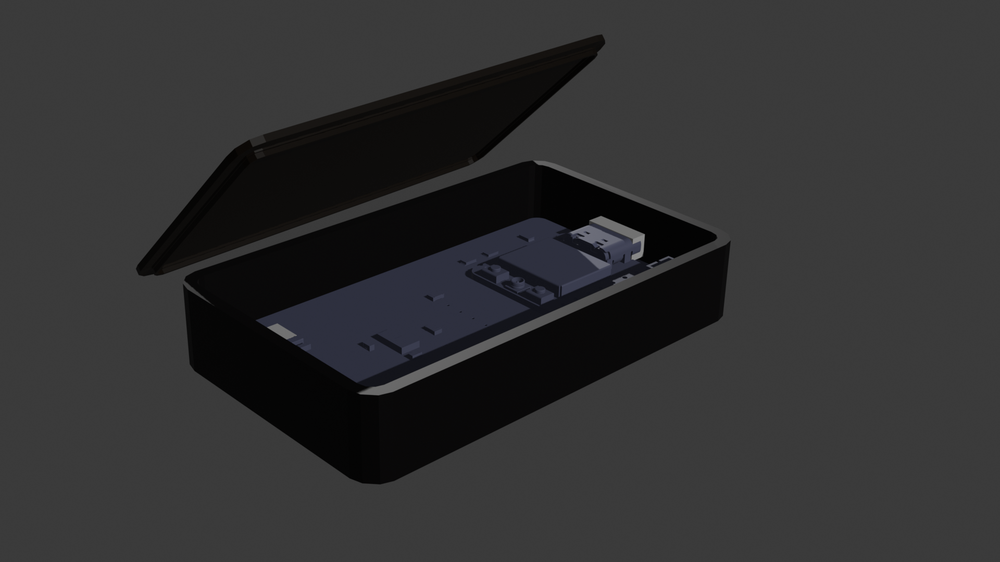
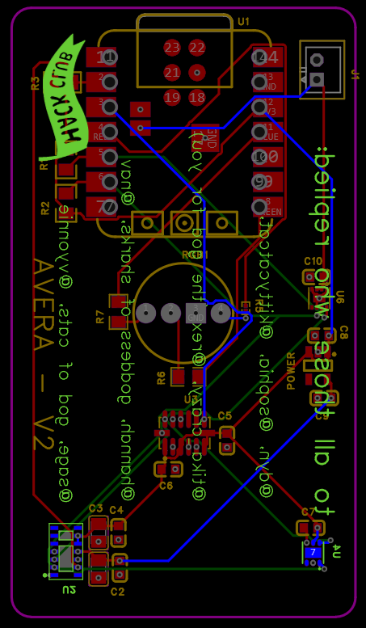
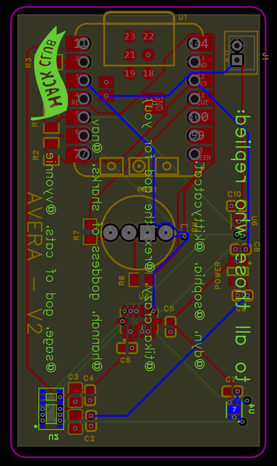
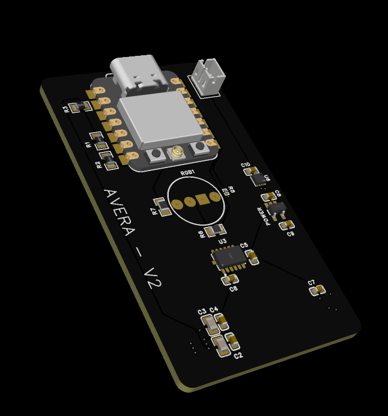
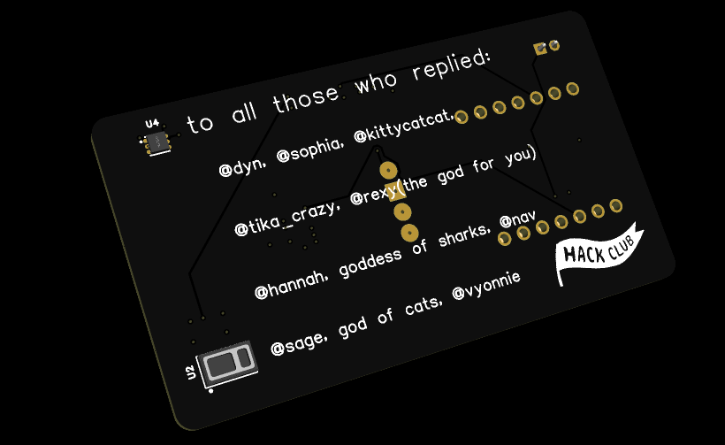
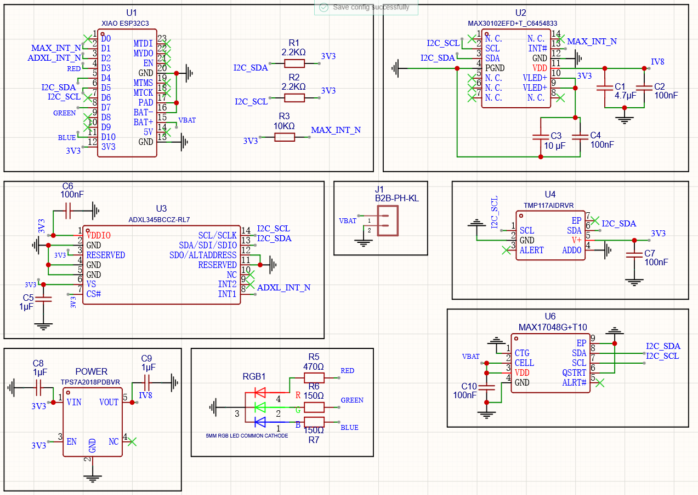

# AVERA Band



hi! this is avera, a screenless health and activity tracking band.

the idea started with wanting to make my own wearable instead of buying one (because whoop is very expensive!). this project is made for [fallen](https://fallen.hackclub.com).

this repository contains the hardware designs, pcb files, firmware, 3d models and other stuff related to the project.

## so, what does it do?

the band uses a few sensors to collect information about the person wearing it:

- **max30102:** heart rate and blood oxygen (spo2)
- **adxl345:** movement and acceleration
- **tmp117:** temperature
- **max17048:** battery monitoring

this whole thing is controlled by an esp32-based microcontroller, and there's also an rgb led for basic status indication.

it currently supports sleep tracking, recovery measurements and basic temperature, heart rate and oxygen level readings.

## hardware

there have been a few changes to the way i'm building the electronics. currently, i'm keeping two approaches in this repository.

### v1.5 (diy / breakout boards)



this is the breakout board approach.

instead of designing a custom pcb with all the individual ICs, i'm using ready-made sensor modules and connecting everything together. this makes the whole thing easier to assemble with a soldering iron and doesn't require getting a custom pcb manufactured.

the v1.5 folder contains the [diy bom](V1.5/BOM/BOM-DIY-V1-5.csv), with the components, quantities and links to purchase them.

### v2 (custom pcb / jlcpcb)



after spending quite some time working with the breakout boards, i decided to try designing a custom pcb instead.

v2 puts the electronics together on a single board. i went with the seeed xiao esp32-c3 as the main controller and designed the schematic around the sensors listed above.

the board also has the required power circuits, resistors, capacitors, connectors and an rgb led.

i designed the schematic and pcb in easyeda. the pcb will be manufactured via jlcpcb.

here are some more views of the pcb:







### schematic



you can find the [easyeda pro source project](V2/hardware/PCB/source/AVERA-V2-SOURCE.epro2), [gerber files](V2/hardware/PCB/gerbers/AVERA-V2-PCB-GERBER.zip), and [pcb step file](V2/hardware/PCB/3d/AVERA-V2-PCB.step) in the v2 hardware folder.

the schematic is also available as a [pdf](V2/hardware/schematic/AVERA-V2-SCHEMATIC.pdf).

the [jlcpcb bom](V2/BOM/BOM-JLCPCB-V2.csv) and [assembly files](V2/hardware/PCB/assembly/) are included as well.

## case design

i'm using blender for the enclosure. this was honestly one of the more frustrating parts of the project because getting the dimensions right took quite a bit of trial and error.

i had to account for the pcb, battery, sensor positions and the space needed for everything to fit inside the case. the optical and temp sensors also need to sit properly against the skin, so the placement of the openings matters.

here's the current design:


the original [blender file](V2/mechanical/source/AVERA.blend) is included, along with the [case](V2/mechanical/STL/AVERA-V2-CASE.stl) and [cover](V2/mechanical/STL/AVERA-V2-COVER.stl) in stl format.

i've also included the [case step file](V2/mechanical/STEP/AVERA-V2-CASE.step) and [cover step file](V2/mechanical/STEP/AVERA-V2-COVER.step).

## pcb assembly

the v2 pcb is planned to be assembled through jlcpcb.

i've included the component placement images and pick-and-place file to make the assembly process easier.

- [top-side assembly image](V2/hardware/PCB/assembly/AVERA_V2_TOP.png)
- [bottom-side assembly image](V2/hardware/PCB/assembly/AVERA_V2_BOTTOM.png)
- [pick and place file](V2/hardware/PCB/assembly/AVERA_V2_PL.csv)
- [assembly notes](V2/hardware/PCB/assembly/ASSEMBLY_NOTES.MD)

## firmware

the firmware is being developed separately for the band. the main controller for v2 is the xiao esp32-c3.

you can find the [xiao esp32-c3 firmware](V2/firmware/xiao_esp32c3/) in its respective folder. the main code is in [`main.cpp`](V2/firmware/xiao_esp32c3/src/main.cpp).

there is also a separate firmware, which uses a dht11 temperature sensor and an arduino uno. it integrates directly with avera-console over usb serial connection.

you can find that sketch [here](V2/firmware/uno_env_dev/uno_env_dev.ino).

the code is still a work in progress. i'll be adding sensor reading, data handling, connectivity and other functionality as i continue testing the hardware after the funding is approved.

## software

there's also a web interface called **avera-console**.

you can find the github repo here:

[avera-console](https://github.com/Aradhya-Shaswat/Avera-Console)

## bills of materials

i've kept the two versions separate because they use different assembly methods.

| version | approach | bom |
|---|---|---|
| v1.5 | diy, using breakout boards | [diy bom](V1.5/BOM/BOM-DIY-V1-5.csv) |
| v2 | custom pcb, jlcpcb assembly | [jlcpcb bom](V2/BOM/BOM-JLCPCB-V2.csv) |

both boms include the parts required for their respective versions, along with purchase links.

## shared files

the [`shared`](shared/) folder contains files that are used across the project.

currently, it includes the [serial communication protocol documentation](shared/protocol/serial-v1.md), which describes the communication used by the arduino uno development setup.

## repository structure

```text
Avera-Band/
|
|-- README.md
|
|-- assets/
|   |-- AVERA-HERO.png
|   |-- AVERA-SECOND.png
|   |-- PCB1.png
|   |-- PCB2.png
|   |-- SCHEMATIC.png
|   |-- 3DPCB.png
|   \-- 3DPCB2.png
|
|-- shared/
|   \-- protocol/
|       \-- serial-v1.md
|
|-- V1.5/
|   \-- BOM/
|       \-- BOM-DIY-V1-5.csv
|
\-- V2/
    |
    |-- BOM/
    |   \-- BOM-JLCPCB-V2.csv
    |
    |-- hardware/
    |   |-- PCB/
    |   |   |-- source/
    |   |   |   \-- AVERA-V2-SOURCE.epro2
    |   |   |-- gerbers/
    |   |   |   \-- AVERA-V2-PCB-GERBER.zip
    |   |   |-- 3d/
    |   |   |   \-- AVERA-V2-PCB.step
    |   |   \-- assembly/
    |   |       |-- ASSEMBLY_NOTES.MD
    |   |       |-- AVERA_V2_TOP.png
    |   |       |-- AVERA_V2_BOTTOM.png
    |   |       \-- AVERA_V2_PL.csv
    |   |
    |   \-- schematic/
    |       \-- AVERA-V2-SCHEMATIC.pdf
    |
    |-- firmware/
    |   |-- uno_env_dev/
    |   |   \-- uno_env_dev.ino
    |   |
    |   \-- xiao_esp32c3/
    |       |-- platform.ini
    |       \-- src/
    |           |-- main.cpp
    |           |-- connectivity/
    |           |-- power/
    |           |-- sensors/
    |           \-- storage/
    |
    \-- mechanical/
        |-- source/
        |   \-- AVERA.blend
        |-- STL/
        |   |-- AVERA-V2-CASE.stl
        |   \-- AVERA-V2-COVER.stl
        \-- STEP/
            |-- AVERA-V2-CASE.step
            \-- AVERA-V2-COVER.step
```

## ai disclosure

the hardware design was done manually. i didn't use autorouting or automated pcb design tools. the schematics, component placement, and pcb routing were all done by me.

that said, i did use llms to help with research, understand component datasheets and pinout diagrams, compare parts, and figure out the overall direction of the project. the actual designing and implementation were done by me.

the software (web interface) was partially developed with the help of ai.

overall, i'd estimate that ai assistance accounts for less than 25% of the project.

## current progress

as of 13th november 2026, the v2 pcb and case have been designed.

the next step is to get the parts and pcb manufactured, assemble everything, and start testing the band with actual hardware.

there's still a lot left to do, but i'll keep updating this repository as i make progress.

thanks for checking this out!